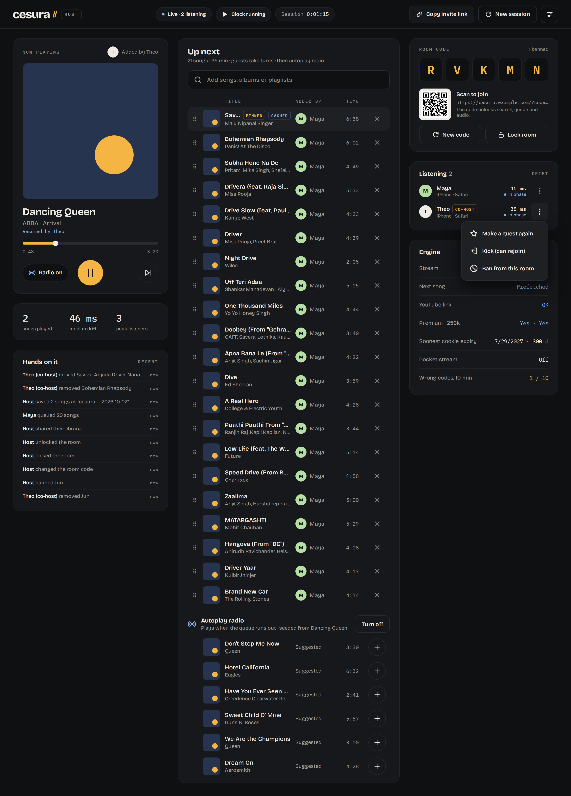
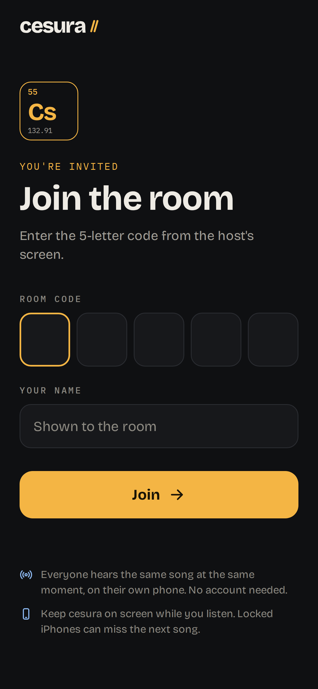
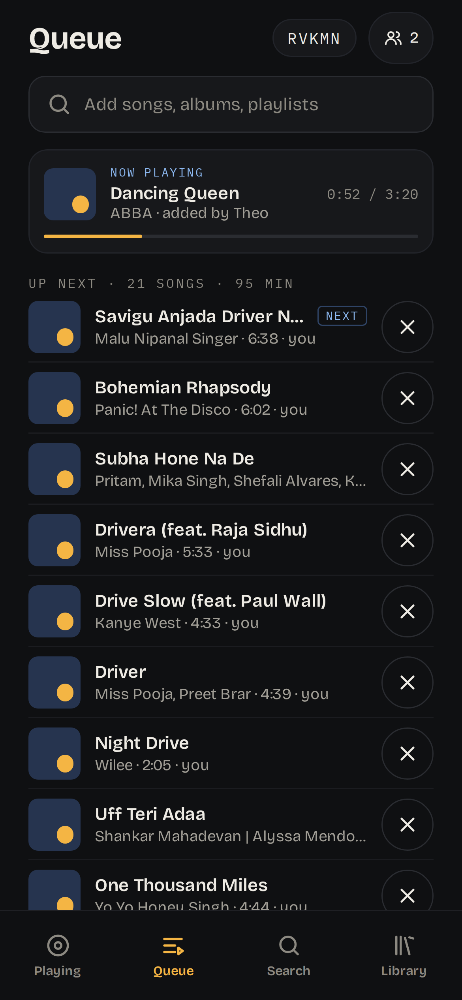
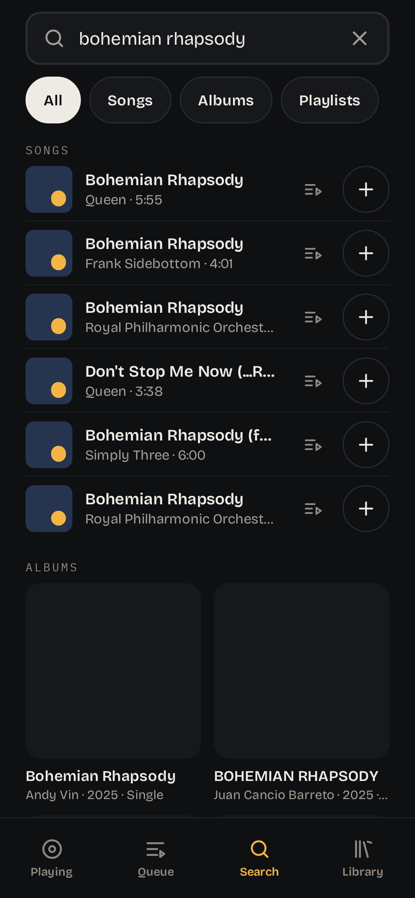
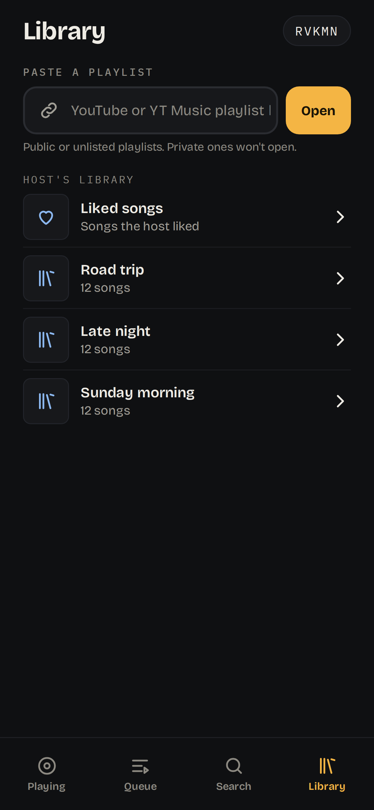
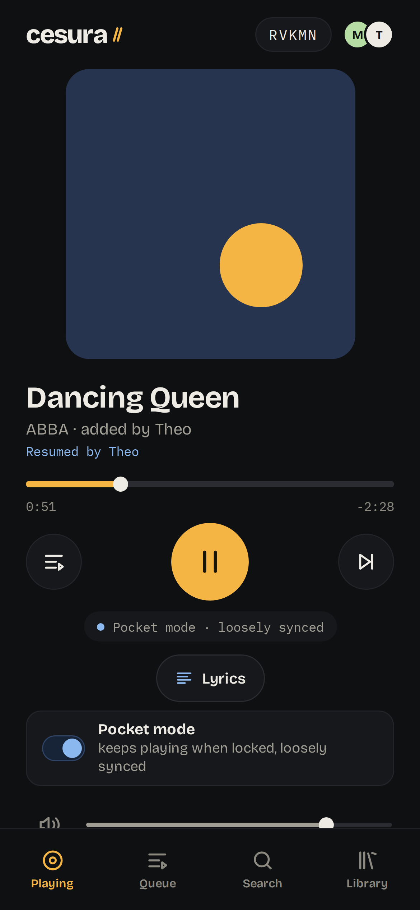

# cesura

**A self-hosted listen-along room for YouTube Music.** Friends join from their phones with a 5-letter code and hear the same song at the same moment on their own devices. Everyone can queue (taking turns), pause for the room and vote to skip. You run it on your own server, with your own YouTube Music account.

<p align="center">
  
</p>



<p>
  
  
  
</p>
<p>
  
  
</p>

*Screenshots use test tones, made-up names and no album art; the room code and address are placeholders.*

> [!WARNING]
> **Unofficial APIs, your account, your risk.** cesura talks to YouTube Music through unofficial, reverse-engineered interfaces ([ytmusicapi](https://github.com/sigma67/ytmusicapi), [yt-dlp](https://github.com/yt-dlp/yt-dlp)) using **your own** signed-in session. It is not affiliated with or endorsed by Google or YouTube, and using it may violate [YouTube's Terms of Service](https://www.youtube.com/t/terms). Your account could be rate-limited or restricted. Use it at your own risk, and keep rooms to people you know.
>
> **Never share your cookies or your cookie file.** It is a login to your Google account.

## What it is

- **Listen-along, not remote control.** Every phone plays the audio itself. The server keeps one clock, and each phone steers its player to match it, typically to within tens of milliseconds of each other.
- **For guests:** join with the code and a name, then search songs, albums and playlists, paste a playlist link, or browse the host's library if they share it. Queue or play next, pause for everyone, vote to skip, read the lyrics. Lock-screen controls and artwork work, there's a per-device volume, and **pocket mode** keeps music going on a locked phone.
- **Fair queue:** everyone takes turns. One person's 30 songs interleave with everyone else's instead of burying them.
- **For the host:** a desktop dashboard with the queue (drag to reorder; swipe and long-press on a phone), autoplay radio, room code + QR, every listener with their live drift, who did what ("hands on it"), and engine health (stream quality, prefetch, YouTube link health and cookie expiry, pocket stream). Kick, ban, lock the room, change the code without kicking anyone, and make trusted guests co-hosts.
- **One container, no database, no accounts.** Everything lives in memory except `config/`. There's a first-run setup wizard, prebuilt images for amd64 and arm64, and a weekly rebuild with the latest yt-dlp.

## Quick start

You need Docker with the Compose plugin, and a YouTube Music account. Premium gets 256k AAC; without it, 128k.

```sh
mkdir -p cesura/config && cd cesura
curl -fsSLO https://raw.githubusercontent.com/acacesius/cesura/main/docker-compose.yml
docker compose up -d && docker compose logs cesura
```

The logs show a box with your **one-time setup token**:

```
========================================================================
  cesura is not set up yet.

  Open  /setup  in your browser and enter this one-time setup token:

      pX3...Qa9

  Only someone with this token can configure this server. It stops
  working as soon as setup is finished.
========================================================================
```

Open `http://127.0.0.1:8765/setup` on the same machine, or through the address you expose it on (see [Exposing it](#exposing-it)). Then paste the token. Lost it? Run `docker compose logs cesura` again: it's printed on every start until setup is done.

> Create `config/` **before** the first `up` (the first command above does). If Docker creates it, it's owned by root, and cesura will print how to fix it.

## The setup wizard

The setup token keeps strangers from claiming a fresh instance: nothing can be configured without it, and it stops working once setup is finished.

1. **Host key.** Generated for you and shown **once**. Save it in a password manager; it opens the host dashboard. Setting `HOST_KEY` in `.env` overrides it.
2. **Public address.** The URL guests will use, for the invite link and QR code. It must be `https://` unless it's localhost. `PUBLIC_URL` in `.env` overrides it.
3. **Link YouTube Music.** Upload a cookies.txt export (guide below). cesura checks it against YouTube right away and tells you what it found, e.g. *"Premium detected · 256k AAC"*, or what to fix. You can skip this step, but playback stays off, and the dashboard shows **YouTube not linked** until you link it.
4. **Done.** You land on the host dashboard at `/host`.

## Linking YouTube Music

cesura streams through your own YouTube Music session, as a `cookies.txt` exported from a **private window**. A normal window keeps using and rotating the same cookies, which breaks the export quickly. A private window that you close right after exporting doesn't.

1. **Install an open-source exporter:**
   - **[Get cookies.txt LOCALLY](https://github.com/kairi003/Get-cookies.txt-LOCALLY)**: [Chrome / Edge / Brave](https://chromewebstore.google.com/detail/get-cookiestxt-locally/cclelndahbckbenkjhflpdbgdldlbecc), [Firefox](https://addons.mozilla.org/firefox/addon/get-cookies-txt-locally/)
   - or, on Firefox, **[cookies.txt](https://github.com/hrdl-github/cookies-txt)**: [Firefox Add-ons](https://addons.mozilla.org/firefox/addon/cookies-txt/)

   ⚠️ Avoid **"Get cookies.txt"** (without "LOCALLY"). It was reported as malware and removed from the Chrome Web Store.
2. **Allow it in private windows.** In Chrome: extension *Details* → **Allow in Incognito**. In Firefox: *Manage extension* → **Run in Private Windows** → Allow.
3. **Open a private (incognito) window** and sign in at [music.youtube.com](https://music.youtube.com).
4. **In the same tab, open `https://www.youtube.com/robots.txt`.** It's a plain page, so YouTube can't rotate your cookies while you export.
5. **Export cookies.txt** from the extension, in Netscape format. Extra sites in the file are fine: cesura keeps only YouTube and Google cookies and drops the rest.
6. **Close the private window. Don't log out**; logging out ends the session you just exported.
7. **Upload the file** in the wizard, or later from the host dashboard (**Relink YouTube**). Then delete your downloaded copy.

What cesura does with the file:
- It accepts only a Netscape cookies.txt up to 256 KB that contains a signed-in session.
- It stores the file as `config/cookies.txt`, readable only by the app (mode 600).
- It never logs, displays or returns cookie values.
- When YouTube rotates cookies during normal use, cesura saves the refreshed ones, but only if the session is still signed in.

The link check reports three things:
- **Account:** YouTube Music confirms the session is signed in.
- **256k AAC:** YouTube offers format 141 for a test song (`PROBE_VIDEO_ID`, default: Queen – *Bohemian Rhapsody*).
- **Premium:** inferred from 256k AAC being available. YouTube has no direct "Premium" flag.

When the link stops working (YouTube's bot check, or the session got signed out), the dashboard shows **YouTube link expired** with a **Relink YouTube** button. Relinking is the same upload and check as in setup.

## Running a room

**Fair queue.** Songs play round-robin by device: one from each person in turn. Someone new joins the rotation right after whoever's playing now. A guest's *Play next* puts that song first among *their own* songs, not ahead of everyone. When the host or a co-host drags a song (or uses *Play next*), it's pinned at that position and the rotation flows around it.

**Vote to skip.** A guest's skip is a vote; the button shows the count. The song skips once votes reach the threshold: by default half of the active listeners (rounded up, at least 1). Pocket listeners don't count towards it. The host sets ¼, ½, ¾ or all in Settings. Votes reset when the song changes. The host and co-hosts skip instantly.

**Hands on it.** Every song shows who queued it, Now Playing shows who last paused or resumed, and the dashboard keeps a feed of recent actions.

**Listeners and moderation.** Each phone or browser is one listener row, however many tabs or reconnects it has (×2 means two open connections). A phone that drops off shows *Reconnecting* for 30 seconds before it leaves the list. From a listener's row menu, the host can:
- **Kick:** closes that device's connections. They can rejoin with the code.
- **Ban:** kicks them, removes their queued songs, and refuses that device for the rest of the server's run. A ban recognises a device by a random ID stored in its browser, so it **only stops casual rejoining**: clearing site data, a private window or another device gets back in with the code. Pair a ban with **New code** to really shut someone out.
- **Make co-host:** a co-host can kick guests, skip without a vote, and reorder or remove queue songs. Co-hosts can't ban, change the code, lock the room, or reach settings or setup; the server enforces this, not just the UI.

On the room code card:
- **New code:** a fresh code, pushed to everyone connected, who stay in. A kicked person's old code stops working. (**New session** still clears everything and disconnects everyone.)
- **Lock room:** refuses new devices with a clear message. Anyone already in this session can still reconnect.

**Host's library** (Settings → *Share my library with guests*, **off by default**, per room). Guests get your YouTube Music playlists and liked songs in their Library tab and can queue from them. It's read-only and uses your linked account; the playlist list is cached for 10 minutes. **Paste a playlist** works without it: any public or unlisted YouTube or YouTube Music playlist link, opened signed out (so private playlists, including yours, never open this way). *Queue all* shuffles and adds up to 50 songs, taking turns like any other add.

**Lyrics.** On Now Playing, from YouTube Music where it has them.

**Save the session.** Settings → *Save session as playlist* creates a private playlist "cesura — <date>" in your YouTube Music library with the songs played this session, in order, without repeats. It asks first.

**YouTube link health.** The link check reruns every 6 hours and when you open the dashboard (at most every 10 minutes). The Engine card shows *OK* (Premium, 256k AAC), *Degraded* (signed in, but no Premium or no 256k) or *Failed*, plus the soonest expiry date among your sign-in cookies. A banner appears whenever it isn't OK.

### Pocket mode (locked iPhones)

A phone normally plays each song file itself and steers it to the room clock. That needs the page running, and iOS freezes a page when the phone locks, so the next song never starts. **Pocket mode** (a switch on Now Playing) instead plays one continuous stream, like an internet radio station. The server makes it once for all pocket listeners: it follows the room clock, switches songs on skip, and plays silence while the room is paused. It runs only while someone uses it, and stops 30 seconds after the last pocket listener leaves.

Honest limits:
- **It's loosely synced.** Pocket listeners hear the room a second or two late, and drift a little, because there's no sync correction. Fine in another room; not for phones side by side.
- **The lock screen may lag.** While the phone is locked, iOS doesn't run the page, so the song title and artwork there can stay on the previous song until you unlock. The audio itself keeps going.
- Lock-screen pause and next work: they pause the room for everyone and vote to skip, as usual.
- It's AAC. If a phone won't play it, set `POCKET_CODEC=mp3`.

## Configuration

Put these in a `.env` file next to `docker-compose.yml` (copy [`.env.example`](.env.example)). All are optional.

| Variable | Default | What it does |
|---|---|---|
| `PORT` | `8765` | Port published on the host. |
| `BIND` | `127.0.0.1` | Interface the port is published on. Docker bypasses host firewalls such as UFW, so this is your real exposure control. Keep `127.0.0.1` and put a reverse proxy or tunnel in front. |
| `PUBLIC_URL` | *(from setup)* | Base URL for the invite link and QR code. Overrides the wizard's value. |
| `TRUSTED_PROXY_CIDR` | `172.16.0.0/12` | `X-Forwarded-For` is trusted only from this network (your proxy, as the container sees it). Rate limits and lockouts are per client IP. |
| `HOST_KEY` | *(from setup)* | Host dashboard key. Overrides the wizard's key. |
| `PROBE_VIDEO_ID` | `BSTsnWoslP4` | Song used by the link check. Change it if that one is unavailable where you are. |
| `POCKET_CODEC` | `aac` | Pocket mode's stream format: `aac`, or `mp3` if some phones won't play it. |
| `CESURA_UID` / `CESURA_GID` | `1000` | User the container runs as. It must own `./config`. |
| `YTM_CLIENT_ID` / `YTM_CLIENT_SECRET` | | Only for optional ytmusicapi OAuth (personalised radio). Not needed. |

## Exposing it

cesura listens on `127.0.0.1:8765`. Put something in front that terminates HTTPS and passes websockets, then set the public address in setup (or `PUBLIC_URL`).

**Reverse proxy** on the same machine, e.g. Caddy:

```
cesura.example.com {
    reverse_proxy 127.0.0.1:8765
}
```

If your proxy runs in Docker on its own network, set `TRUSTED_PROXY_CIDR` to that network.

**Tunnel** (Cloudflare Tunnel, ngrok and similar): point it at `http://127.0.0.1:8765` and use the tunnel's HTTPS address as the public URL.

**Tailscale.** `serve` shares it inside your tailnet; `funnel` makes it public (Funnel allows ports 443, 8443 and 10000):

```sh
tailscale serve status --json > serve-backup.json                 # save what's there first
sudo tailscale serve  --bg --https=8765 http://127.0.0.1:8765     # tailnet only
sudo tailscale funnel --bg --https=8443 http://127.0.0.1:8765     # public internet
```

> [!CAUTION]
> **Never run `tailscale serve --https=<port> off`** to remove an entry. On some versions it wipes **all** serve and Funnel configuration on the machine, not just that port. Keep the backup from above so you can recreate anything that gets lost.

While exposed:
- guests need the current room code for everything, including audio; after joining, each device also gets a session token that audio, pocket mode and every action require, and that kicking revokes;
- the dashboard needs the host key;
- each IP gets 10 wrong codes or keys per 10 minutes before a lockout;
- adds are rate-limited.

Press **New session** after a party to rotate the code (or **New code** to rotate it without ending the session).

## Updating

```sh
docker compose pull && docker compose up -d
```

- **`:latest`** is rebuilt **weekly** with the newest yt-dlp, yt-dlp-ejs and ytmusicapi, and only published if its smoke tests pass. YouTube changes break these libraries regularly, so pulling is usually the fix.
- **Versioned tags** (`:0.1.0`, …) are published for each release, if you want to pin one.
- **Source installs** (`docker-compose.dev.yml`): run `./update.sh`. It bumps those three libraries to their latest releases, rebuilds, restarts and runs the self-test.

To check a running install: `docker compose exec cesura python -m app.selftest`

## Troubleshooting

| Symptom | Fix |
|---|---|
| **"YouTube link expired"** on the dashboard | Export fresh cookies from a *new* private window (guide above) and use **Relink YouTube**. |
| **Bot check**: "Sign in to confirm you're not a bot" in the logs, or the link check says so | Same as above. Datacenter/VPS IPs get this far more often than home connections. |
| Everything skips, `could not load` in the logs, `Requested format is not available` | Update: `docker compose pull && docker compose up -d` (source installs: `./update.sh`). |
| Link check: "Signed in · no Premium detected · 128k AAC" | Works, but at 128k. Export from the account that has Premium. |
| "config is not writable" box in the logs | `sudo chown -R 1000:1000 ./config`, or set `CESURA_UID`/`CESURA_GID` to the owner of `./config`. |
| Lost the setup token | `docker compose logs cesura`. It's reprinted on every start until setup finishes. |
| Lost the host key | Stop the container, delete `config/host_key` and `config/setup.json`, and start again. A new setup token is printed; your cookies stay linked. |
| Phones play but drift | Check the Listening card. "Catching up" should settle within seconds. Very slow networks may need a moment after seeks. |

## Known limits

- **Locked iPhones.** In normal mode iOS may finish the current song but not start the next one while the screen is locked. Keep cesura on screen (over HTTPS it holds a wake lock), or switch on **pocket mode**, which keeps playing but is only loosely synced (see above).
- **iOS volume.** Web pages can't set volume on iOS, so the slider is hidden there; use the hardware buttons.
- **Open controls.** Anyone with the room code can queue, pause for everyone and vote to skip. Kick, ban and Lock room help, but bans only stop casual rejoining (see above).
- **One room per instance.** State is in memory: a restart ends the session, changes the code and forgets bans.
- **Unofficial APIs.** It breaks when YouTube changes things; update, and relink when asked.

## Development

```sh
git clone https://github.com/acacesius/cesura && cd cesura
mkdir -p config
docker compose -f docker-compose.dev.yml up -d --build
python3 tests/smoke.py --image cesura:dev     # the same smoke test CI runs before publishing
pip install -r requirements-dev.txt && python -m pytest tests/   # unit + API tests (needs ffmpeg)
```

End-to-end, with synthetic audio and a fake host library (no YouTube account needed):

```sh
docker run -d --name cesura-fake -p 127.0.0.1:18765:8765 -v "$PWD/tests:/app/tests:ro" -v "$(mktemp -d):/app/config" \
  -e HOST_KEY=test-host-key -e FAKE_CODE=TQWXZ cesura:dev python -m tests.fakeserver
docker run --rm --network host -v "$PWD:/src" -w /src mcr.microsoft.com/playwright/python:v1.55.0-noble \
  sh -c 'pip install -q playwright==1.55.0 && python tests/e2e.py --base http://127.0.0.1:18765 --code TQWXZ --key test-host-key'
```

- **Server:** FastAPI + uvicorn in `app/`.
- **Frontend:** plain HTML/JS in `static/`, with no build step.
- **Streams:** resolved once by yt-dlp (running YouTube's player JS in Deno), held in memory, and served to every listener with HTTP Range support.
- **Sync:** each phone measures its clock offset to the server with ping/pong. It seeks when it's more than 1 s off, and nudges `playbackRate` by ±5% (inaudible) for smaller drift.
- **Listeners:** devices, not sockets (`app/presence.py`): 10 s heartbeat, closed after 3 missed, 30 s grace. **Fair queue:** `app/fair.py`. **Pocket mode:** `app/pocket.py`, a persistent ffmpeg encoder fed in real time by a per-song decoder reading the in-memory proxy, fanned out through a ring buffer.
- **Design system:** `static/ds/` is shared with [rubato](https://github.com/acacesius/rubato); see [`static/ds/README.md`](static/ds/README.md).

## License

MIT. See [LICENSE](LICENSE). The bundled fonts, Bricolage Grotesque and IBM Plex Mono, are under the SIL Open Font License; see `static/ds/fonts/`.
